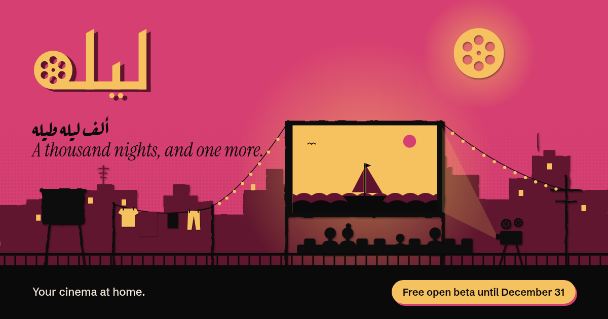
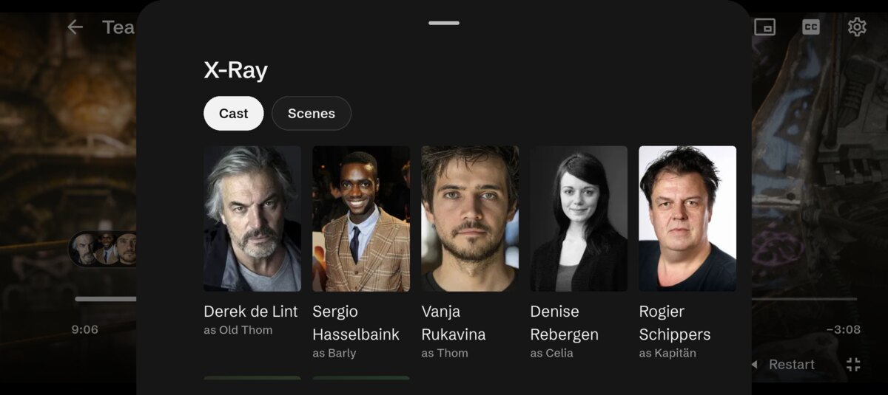
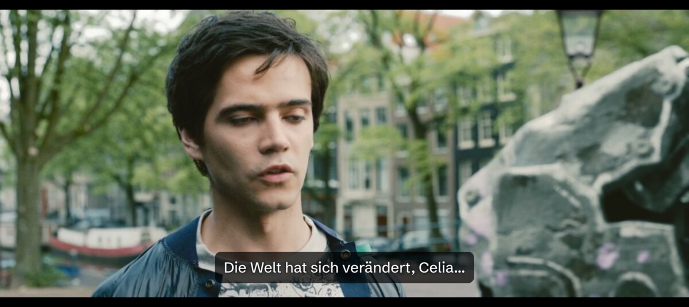
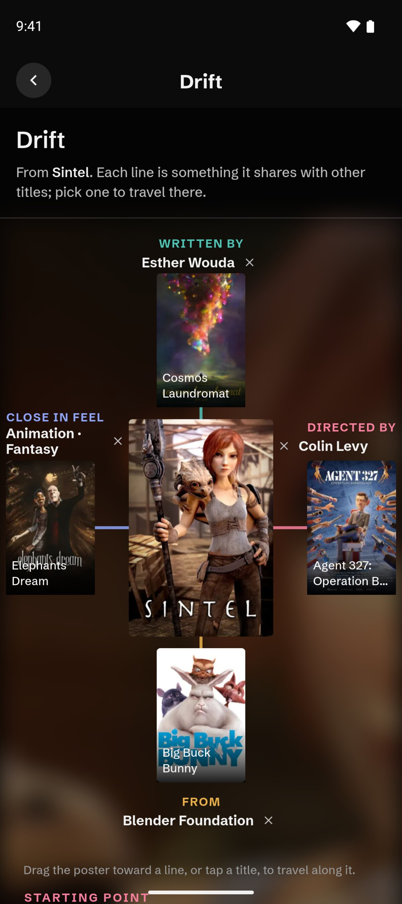
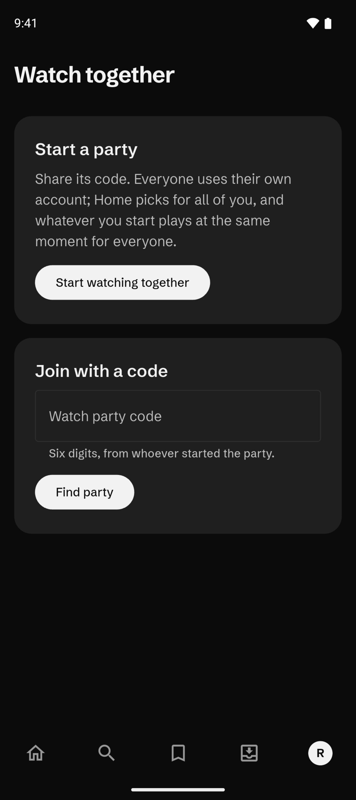

#  Leyla

A media server for the films and shows you own. It runs on a computer that
stays on, and plays on your phone, TV and browser.

**[leyla.media](https://leyla.media)** has the downloads, the docs and the
pricing. Leyla is free during the open beta, until December 31, 2026.

## What it looks like

  
  

  
  

Films shown are Blender Foundation open movies (Sintel, Tears of Steel,
Spring, Cosmos Laundromat), under CC BY.

## Get it

- Server: Docker, Linux packages, Windows. [Download](https://leyla.media/download)
- Apps: Android, Android TV, iPhone and iPad, and any browser.
  [Download](https://leyla.media/download)

## Reporting a problem

Open an issue here with what you did, what you expected and what happened.
Leave out anything private: a server's support bundle is already free of
names and addresses.

## The source we publish

Leyla itself is closed source, under the beta licence. The open parts are
here:

- [leyla-ffmpeg](https://github.com/tropicalthink/leyla-ffmpeg): the ffmpeg Leyla ships
- [leyla-libmpv](https://github.com/tropicalthink/leyla-libmpv): the LGPL libmpv build
- [leyla-audio-decode](https://github.com/tropicalthink/leyla-audio-decode): DTS and TrueHD decoding for the web client
- [leyla-home-assistant](https://github.com/tropicalthink/leyla-home-assistant): the Home Assistant integration

The open-source software inside Leyla is listed at
[leyla.media/notices](https://leyla.media/notices).
